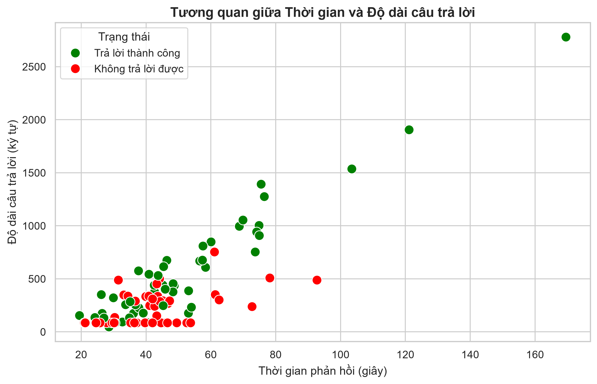

# ⚖️ Chatbot Pháp luật Việt Nam (Vietnamese Legal RAG Chatbot)


## 📖 Tổng quan dự án
Đây là một hệ thống Chatbot chuyên về tư vấn pháp luật Việt Nam, được xây dựng dựa trên kiến trúc **Advanced RAG (Retrieval-Augmented Generation)**. 

Hệ thống giải quyết bài toán "ảo giác" (hallucination) bằng cách truy xuất các Điều luật chính xác từ cơ sở dữ liệu nội bộ trước khi sinh câu trả lời. Điểm đặc biệt là hệ thống được tối ưu hóa để chạy **hoàn toàn Local trên CPU**, không yêu cầu GPU đắt tiền hay API trả phí.

**Dữ liệu trọng tâm:** 7.868 Điều luật cốt lõi trích xuất từ 52 Bộ luật/Luật quan trọng nhất của Việt Nam (Dân sự, Hình sự, Hôn nhân, Đất đai, Doanh nghiệp, Tố tụng...), đã được cập nhật theo Văn bản hợp nhất (VBHN) 2025.

## 📚 Tài liệu & Báo cáo Đánh giá (Dành cho Giảng viên)
- 📄 **[BÁO CÁO ĐÁNH GIÁ HỆ THỐNG](./report_assets/DEMO_FINAL_REPORT.md)**
  *(Chi tiết quá trình phân tích, kiến trúc, kết quả test 100 câu và đánh giá ưu/nhược điểm).*
- 📊 **[File kết quả Test 100 câu](./demo_results.csv)**
  *(Xem chi tiết từng câu hỏi, câu trả lời của Bot, thời gian phản hồi và nguồn trích dẫn).*

## 🚀 Tính năng nổi bật
- **Zero Hallucination (Chống ảo giác):** Từ chối trả lời nếu không tìm thấy thông tin trong cơ sở dữ liệu (Tỷ lệ từ chối 100% đối với câu hỏi bẫy).
- **Smart Filter (Regex):** Tự động nhận diện Tên Luật + Số Điều (VD: "Điều 33 Luật Hôn nhân") để tìm kiếm chính xác tuyệt đối.
- **Hybrid Search & Reranker:** Kết hợp tìm kiếm từ khóa (BM25) và ngữ nghĩa (FAISS), sau đó dùng mô hình Reranker để chọn ra 5 điều luật tinh túy nhất.
- **Trích dẫn nguồn minh bạch:** Luôn hiển thị số hiệu văn bản, tiêu đề Điều luật và thời gian phản hồi.
- **Giao diện Web Streamlit:** Chia 2 cột (Thư viện luật & Khung chat), hỗ trợ streaming chữ.

## 🏗️ Kiến trúc hệ thống (Pipeline)
1. **Dữ liệu (Data):** Gộp thành **7.868 Điều luật** hoàn chỉnh (giữ nguyên vẹn ngữ cảnh).
2. **Embedding:** Mô hình tối ưu tiếng Việt `keepitreal/vietnamese-sbert` (768 chiều).
3. **Vector Database:** `FAISS` kết hợp `BM25` (Hybrid Search).
4. **Reranker:** Mô hình `BAAI/bge-reranker-base`.
5. **LLM Generation:** Mô hình `Qwen2.5-3B-Instruct` (GGUF Q4_K_M) chạy local qua `llama-cpp-python`.

---

## 🎯 Đánh giá Hiệu năng Hệ thống
Hệ thống được đánh giá tự động trên bộ **100 câu hỏi test** trải đều các nhóm ngành luật và 10 câu hỏi bẫy.

<p align="center">
  
  
</p>
<p align="center">
  
</p>
<p align="center">
  
</p>

---

## ⚙️ Hướng dẫn Cài đặt & Chạy

### 1. Yêu cầu hệ thống
- Python 3.10 trở lên.
- RAM: Tối thiểu 8GB.
- Dung lượng trống: ~4GB (cho code, model và index).

### 2. Tải Source Code
```bash
git clone https://github.com/shirmtry/SEG301m.git
cd SEG301m
```

### 3. Tạo Môi trường ảo (Virtual Environment) & Cài đặt Thư viện
```bash
python -m venv venv
venv\Scripts\activate  # Trên Windows
# source venv/bin/activate  # Trên macOS/Linux
pip install -r requirements.txt
```

### 4. Tải Dữ liệu & Mô hình (Bắt buộc)
Do dung lượng vượt giới hạn GitHub, bạn **BẮT BUỘC** phải tải thủ công 2 thành phần từ thư mục lưu trữ dưới đây:
- 📥 **Link thư mục chứa Data & Model:** **[MediaFire - DATA + MODEL HTK](https://www.mediafire.com/folder/2iiyg8ix6vx1y/DATA_%2B_MODEL_HTK)**

**Hướng dẫn cài đặt:**
1. Tải file `legal_data.zip` và thư mục `qwen_model`.
2. Giải nén `legal_data.zip`, bạn sẽ nhận được file `legal_merged.jsonl` và thư mục `faiss_index_new`. Copy chúng vào thư mục gốc của dự án.
3. Copy file `qwen2.5-3b-instruct-q4_k_m.gguf` vào thư mục `qwen_model/` của dự án.

---

## 🎯 Hướng dẫn Sử dụng

### Chạy giao diện Web (Streamlit)
```bash
python -m streamlit run app.py
```
Trình duyệt sẽ tự động mở tại `http://localhost:8501`. Gõ câu hỏi và xem kết quả kèm nguồn trích dẫn.

### Chạy Bài Test Đánh Giá (Dành cho Báo cáo)
Script này sẽ chạy 100 câu hỏi mẫu, đo thời gian phản hồi và xuất ra file `demo_results.csv`:
```bash
python code-htk/run_tests.py
```

---

## 📂 Cấu trúc thư mục
```text
├── app.py                  # Giao diện Web Streamlit
├── code-htk/
│   ├── run_tests.py        # Script chạy Test 100 câu hỏi
│   └── visualize_report.py # Script vẽ biểu đồ đánh giá
├── legal_merged.jsonl      # Cơ sở dữ liệu 7.868 Điều luật
├── faiss_index_new/        # Thư mục chứa FAISS Index
├── qwen_model/             # Chứa LLM Qwen GGUF
├── report_assets/          # Chứa Báo cáo (.md) và các biểu đồ (.png)
├── demo_results.csv        # Kết quả test 100 câu
└── requirements.txt        # Danh sách các thư viện cần thiết
```

---

## ⚠️ Hạn chế & Hướng phát triển
1. **Tốc độ trên CPU:** Qwen 3B chạy trên CPU mất khoảng trung bình **47.11 giây/câu** (do không có GPU). Nếu có GPU hoặc sử dụng vLLM, tốc độ có thể giảm xuống dưới 3 giây.
2. **Thiếu hụt văn bản dưới luật:** Hệ thống thiếu các Nghị định xử phạt (Giao thông, Môi trường), dẫn đến việc không trả lời được các câu hỏi về mức phạt cụ thể.
3. **Bộ lọc Regex quá khắt khe:** Nếu người dùng hỏi "Điều 123" nhưng văn bản ghi "Điều 123a", hệ thống có thể bỏ sót.
4. **Mở rộng dữ liệu:** Có thể bổ sung thêm các Nghị định, Thông tư để tăng độ phủ của Chatbot.

---

## 👨‍💻 Tác giả
- **Sinh viên thực hiện:** HUYTKING (shirmtry)
- **Môn học:** SEG301m