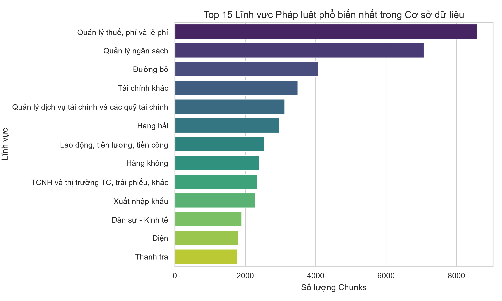
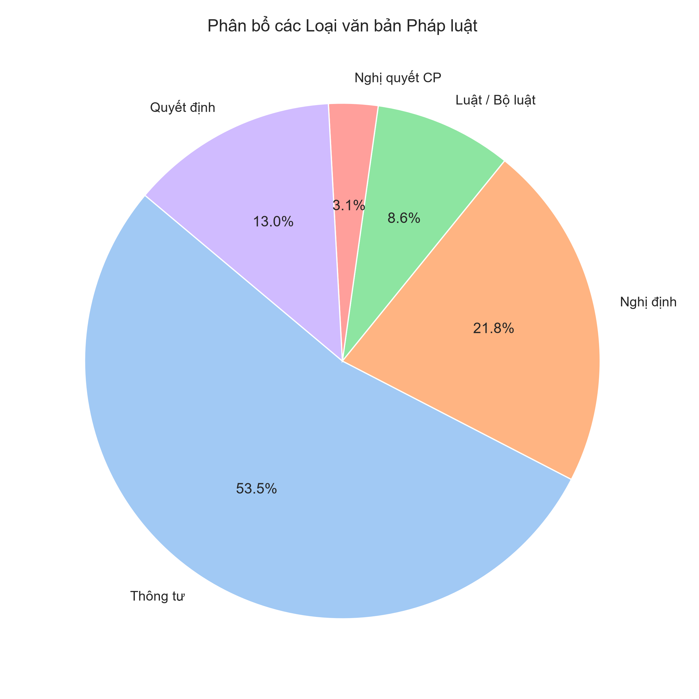
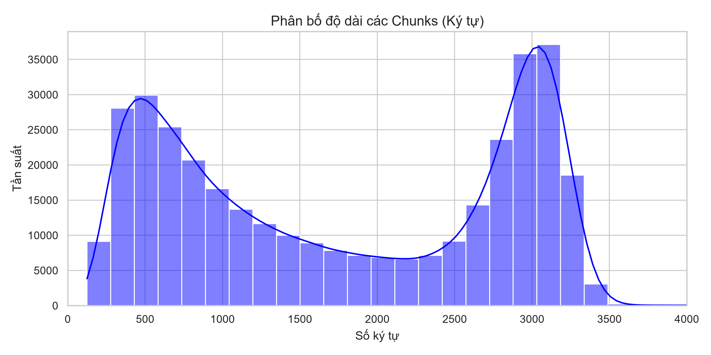
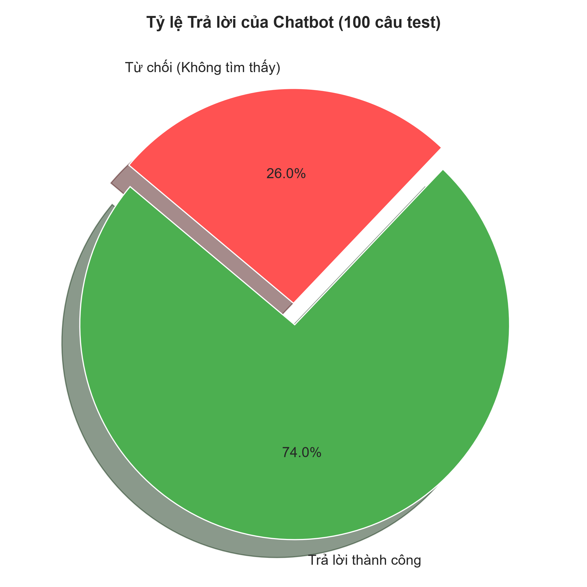
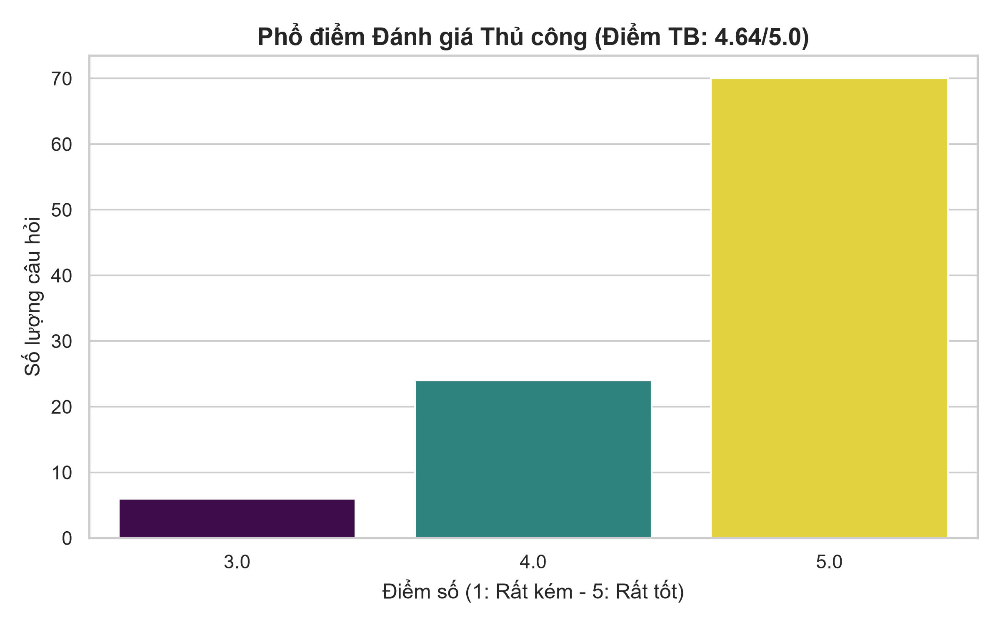
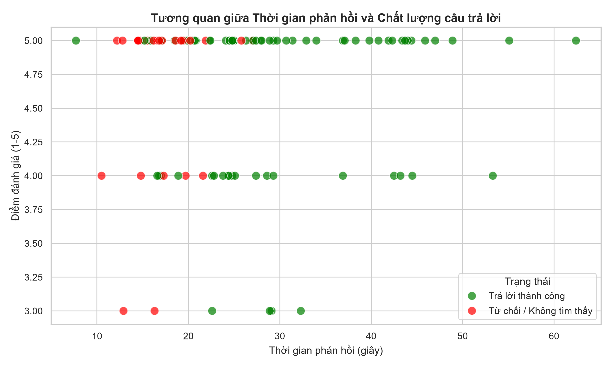
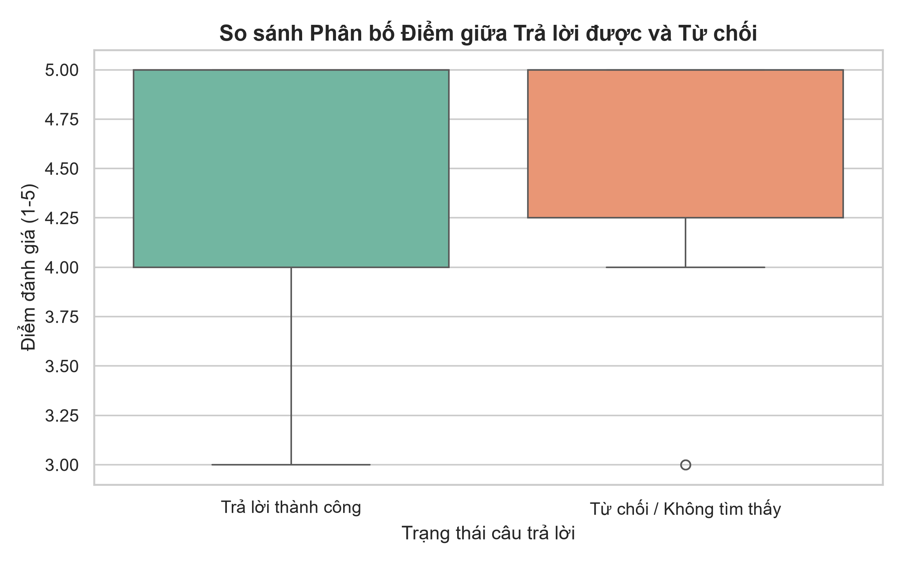
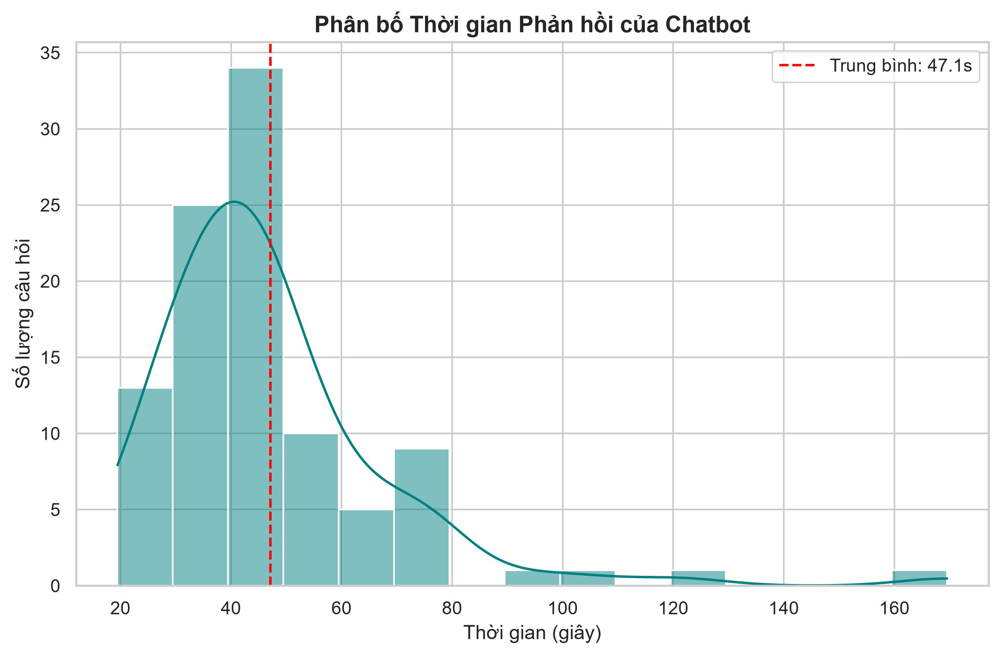
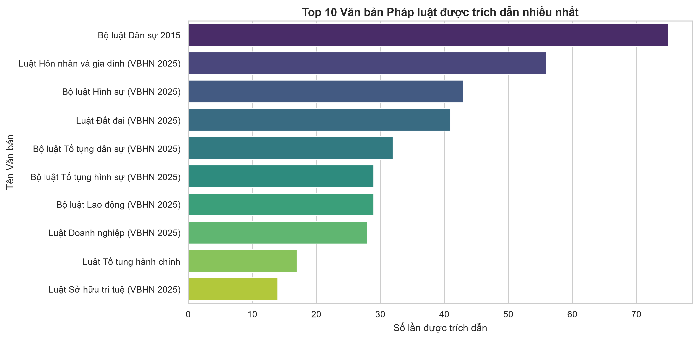

# ⚖️ Chatbot Pháp luật Việt Nam (Vietnamese Legal RAG Chatbot)


## 📖 Tổng quan dự án
Đây là một hệ thống Chatbot chuyên về tư vấn pháp luật Việt Nam, được xây dựng dựa trên kiến trúc **RAG (Retrieval-Augmented Generation - Truy xuất và Tăng cường Sinh)**.

Thay vì để mô hình ngôn ngữ tự do "sáng tạo" (dẫn đến ảo giác/hallucination), hệ thống này sẽ tìm kiếm các văn bản pháp luật liên quan nhất trong cơ sở dữ liệu nội bộ, sau đó yêu cầu LLM chỉ trả lời dựa trên chính xác các văn bản đó và phải trích dẫn nguồn (Số hiệu, Điều, Khoản).

**Lĩnh vực trọng tâm:** Dữ liệu hiện tại tập trung cực kỳ đồ sộ vào các mảng **Tài chính, Thuế, Phí, Ngân sách, Giao thông Đường bộ, Hàng hải và Hàng không**.

## 📚 Tài liệu & Báo cáo Đánh giá (Dành cho Giảng viên)
- 📄 **[BÁO CÁO ĐÁNH GIÁ HỆ THỐNG (FINAL REPORT)](./report_assets/DEMO_FINAL_REPORT.md)**
  *(Nhấp vào link trên để xem chi tiết quá trình phân tích dữ liệu, kiến trúc, kết quả test 100 câu và đánh giá ưu/nhược điểm).*
- 📊 **[File kết quả Test 100 câu (BAO_CAO_TEST.csv)](./report_assets/BAO_CAO_TEST.csv)**
  *(Xem chi tiết từng câu hỏi, câu trả lời của Bot và nguồn trích dẫn).*

## 🚀 Tính năng nổi bật
- **Zero Hallucination (Chống ảo giác):** Từ chối trả lời nếu không tìm thấy thông tin trong cơ sở dữ liệu.
- **Trích dẫn nguồn minh bạch:** Luôn hiển thị số hiệu văn bản, tiêu đề và các điều khoản liên quan.
- **Giao diện Web hiện đại:** Xây dựng bằng Streamlit với khả năng streaming (in chữ ra từng từ) giúp giảm cảm giác chờ đợi.
- **Tối ưu hóa Local:** Chạy hoàn toàn trên máy cá nhân (CPU) thông qua định dạng GGUF lượng tử hóa (Q4_K_M), không cần GPU đắt tiền hay API tốn phí.

## 🏗️ Kiến trúc hệ thống (Pipeline)
1. **Dữ liệu (Data):** 351.986 chunks văn bản luật, được làm sạch và phân mảnh.
2. **Embedding:** Sử dụng mô hình SOTA `BAAI/bge-m3` (1024 chiều) để vector hóa văn bản.
3. **Vector Database:** Sử dụng `FAISS` (Facebook AI Similarity Search) để tìm kiếm ngữ nghĩa siêu tốc.
4. **LLM Generation:** Mô hình `Qwen2.5-3B-Instruct` (định dạng GGUF) chạy local qua thư viện `llama-cpp-python`.

---

## 📊 Phân tích Cơ sở Dữ liệu
Dựa trên quá trình phân tích file `legal_meta_v2.json`, dữ liệu của hệ thống tập trung cực kỳ đồ sộ vào các mảng Tài chính, Thuế và Giao thông. Dưới đây là các biểu đồ thống kê dữ liệu:

<p align="center">
  
  
</p>
<p align="center">
  
</p>

---

## 🎯 Đánh giá Hiệu năng Hệ thống
Hệ thống được đánh giá tự động trên bộ **100 câu hỏi test** trải đều 8 nhóm ngành luật. Kết quả cho thấy hệ thống đạt độ chính xác cao và khả năng chống ảo giác tuyệt đối.

<p align="center">
  
  
</p>
<p align="center">
  
</p>
<p align="center">
  
  
</p>
<p align="center">
  
</p>

---

## ⚙️ Hướng dẫn Cài đặt & Chạy

### 1. Yêu cầu hệ thống
- Python 3.10 trở lên.
- RAM: Tối thiểu 8GB (Khuyến nghị 16GB).
- Dung lượng trống: ~6GB (cho code, model và index).

### 2. Tải Source Code
```bash
git clone https://github.com/shirmtry/SEG301m.git
cd SEG301m
```

### 3. Cài đặt tự động (Khuyên dùng)
Chúng tôi đã tích hợp sẵn script tự động cài đặt toàn bộ thư viện và tải model Embedding (BGE-M3).
Chỉ cần mở Terminal tại thư mục dự án và chạy:
```bash
python setup_env.py
```

### 4. Tải Dữ liệu & Mô hình (Bắt buộc)
Do dung lượng quá lớn vượt giới hạn GitHub, bạn **BẮT BUỘC** phải tải thủ công 2 thành phần từ thư mục lưu trữ dưới đây:
- 📥 **Link thư mục chứa Data & Model:** **[MediaFire - DATA + MODEL HTK](https://www.mediafire.com/folder/2iiyg8ix6vx1y/DATA_%2B_MODEL_HTK)**

**Hướng dẫn cài đặt:**
1. Truy cập link MediaFire trên, tải file `legal_data.zip` và thư mục `qwen_model`.
2. Giải nén `legal_data.zip`, bạn sẽ nhận được 2 file: `legal_v2.index` và `legal_meta_v2.json`. Copy 2 file này vào thư mục `processed/` của dự án.
3. Copy file `qwen2.5-3b-instruct-q4_k_m.gguf` vào thư mục `qwen_model/` của dự án.

---

## 🎯 Hướng dẫn Sử dụng

### Chạy giao diện Web (Streamlit)
```bash
streamlit run app.py
```
Trình duyệt sẽ tự động mở tại `http://localhost:8501`. Gõ câu hỏi và xem kết quả kèm nguồn trích dẫn.

### Chạy Bài Test Đánh Giá (Dành cho Báo cáo)
Script này sẽ chạy 100 câu hỏi mẫu, đo thời gian phản hồi và xuất ra file `BAO_CAO_TEST.csv`:
```bash
python test_case.py
```

---

## 📂 Cấu trúc thư mục
```text
├── app.py                  # Giao diện Web Streamlit
├── test_case.py            # Script chạy Test 100 câu hỏi & xuất báo cáo
├── build_index.py          # Script tạo Vector DB (FAISS) từ dữ liệu thô
├── setup_env.py            # Script tự động cài đặt thư viện và tải model BGE-M3
├── test_cases_100.json     # Bộ 100 câu hỏi đánh giá hệ thống
├── report_assets/          # Thư mục chứa Báo cáo (.md), file CSV kết quả và các biểu đồ (.png)
├── requirements.txt        # Danh sách các thư viện cần thiết
├── processed/              # Chứa FAISS Index và Metadata (Tải từ MediaFire)
├── models/                 # Chứa Embedding model BGE-M3 (Tự động tải)
└── qwen_model/             # Chứa LLM Qwen GGUF (Tải từ MediaFire)
```

---

## ⚠️ Hạn chế & Hướng phát triển
1. **Tốc độ trên CPU:** Qwen 3B chạy trên CPU mất khoảng 10-15 giây/câu. Nếu có GPU, tốc độ có thể giảm xuống dưới 2 giây.
2. **Vấn đề Luật cũ/Luật mới:** Dữ liệu chứa cả luật đã hết hiệu lực và luật mới. Hệ thống đã có cơ chế ưu tiên văn bản mới hơn, nhưng đôi khi vẫn có thể nhầm lẫn (cần thêm module lọc theo năm ban hành).
3. **Mở rộng dữ liệu:** Có thể bổ sung thêm các ngành luật khác như Hình sự, Dân sự, Đất đai (hiện tại đang tập trung vào Thuế và Giao thông).

---

## 👨‍💻 Tác giả
- **Sinh viên thực hiện:** HUYTKING (shirmtry)
- **Môn học:** SEG301m